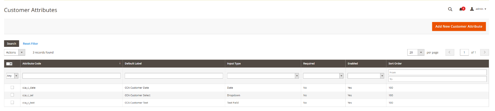
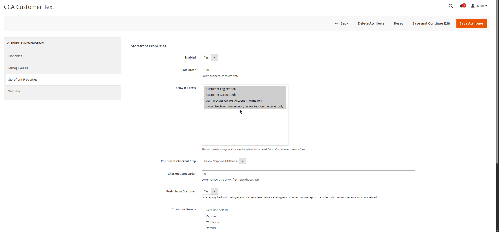

# 3. Managing attributes

Open **Stores → Attributes → Customer Attributes** or **Customer Address Attributes**. System attributes (first name, street,
…) are not listed and cannot be changed here.

## The grid

Lists the user-defined attributes with code, default label, input type, required, enabled and sort order. You can filter and sort
by each column.

**Mass actions** (select rows, choose an action): **Enable**, **Disable**, **Delete**. Enable and disable change the attribute's
global enabled flag; overrides per website are kept.

## Creating an attribute

Click **Add New Customer Attribute** (or **Add New Customer Address Attribute**) and fill the tabs.

### Properties

| Field | Notes |
|---|---|
| Default Label | shown on forms and in order displays |
| Attribute Code | lowercase letters, digits and underscores, starting with a letter. At most 51 characters for customer attributes and 60 for address attributes. Cannot collide with columns of the customer, quote or order tables. **Cannot be changed later** |
| Input Type | text field, text area, date, yes/no, dropdown, multiple select. **Cannot be changed later** |
| Values Required | the field must be filled where it is shown |
| Default Value | for text, text area and yes/no; for dropdown and multiple select mark the default option |
| Options | for dropdown and multiple select: value labels (also per store view), default option, drag to sort |
| Input Validation | text field and text area: letters and numbers, numbers, letters, URL, email or length only; minimum and maximum text length |
| Date range | date attributes: minimum and maximum date |

### Manage Labels

A label per store view. Order displays use the label that was current when the order was placed.

### Storefront Properties

| Field | Notes |
|---|---|
| Enabled | switches the attribute on or off everywhere on the storefront |
| Sort Order | lower numbers first |
| Show in Forms | where the attribute appears, see below |
| Customer Groups | show only to the selected groups; empty means all groups, see [Dependencies and groups](06-dependencies.md) |
| Position at Checkout Step, Checkout Sort Order, Prefill from Customer | customer attributes only, greyed out until "Hyvä Checkout" is ticked in Show in Forms, see [Customer attributes](04-customer-attributes.md) |

**Show in Forms for customer attributes**

| Option | Effect |
|---|---|
| Customer Registration | the registration form |
| Customer Account Edit | the Account Information form |
| Admin Order Create (Account Information) | the admin order form |
| Hyvä Checkout | own sections in the Hyvä Checkout |

**Show in Forms for address attributes**

| Option | Effect |
|---|---|
| Registration Address Form | the registration address form |
| Address Book (Customer Account) | the Add/Edit Address form in the account |
| Hyvä Checkout Address Forms | the shipping and billing address forms of the checkout |
| Address Text | the value is added to the address text everywhere an address is displayed |

The admin customer and address forms always include every attribute.

### Storefront Display ("Display As", Advanced tab)

For dropdown, yes/no and multiple select attributes: show a dropdown or yes/no as **radio buttons**, a multiple select as
**checkboxes**. The stored data and the API do not change.

### Websites

For an existing attribute, each website can override three things: **Enabled**, **Values Required** and **Default Value**
(text, text area, yes/no). "Use Default" keeps the value from the Properties tab. Code, input type, options, rules and forms are
shared by all websites. Forms, the API and validation follow the website the customer is on. The admin order and customer forms
use the default values. The tab appears once the attribute has been saved.

## Validation messages in the admin

Saving checks, before anything is stored: a label is present, the code format and length, a duplicate code, reserved codes, a
valid input type, unique option values, consistent length and date ranges, and that a dropdown has options. The same checks run
by AJAX when you click Save.

## Editing and deleting

- Labels, options, validation, forms, groups, websites and the enabled flag can be changed at any time.
- Deleting an attribute removes its definition and the values on customers, addresses and quotes. **Orders keep their snapshot**
  (label and value) because the order tables have no link to the attribute.

## Permissions

System → Permissions → User Roles → Role Resources → Stores → Attributes has three resources: **Customer Attributes**,
**Customer Address Attributes** and **Attribute Relations**. A role with only one of them sees only that menu entry; requests for
another area (also with a changed `entity` parameter) are refused with 403.
