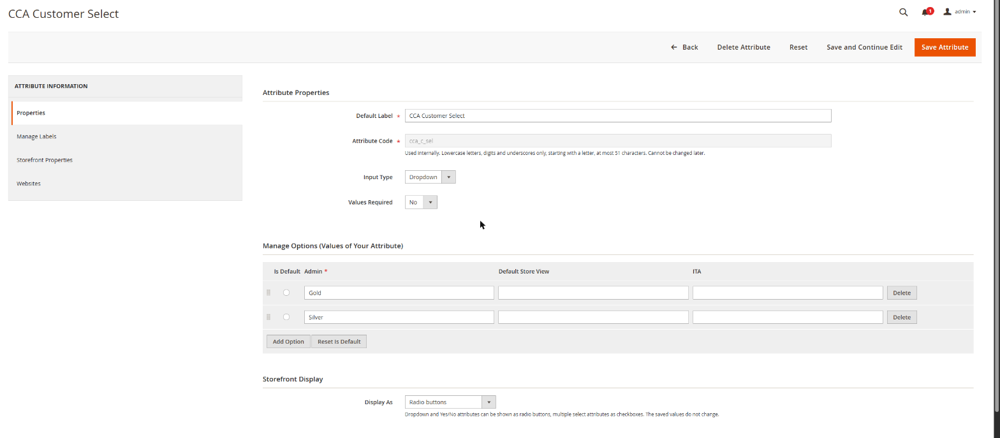
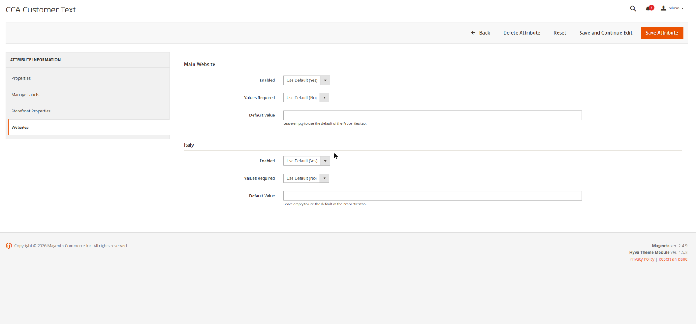

# 3. Managing attributes

Open **Stores → Attributes → Customer Attributes** or **Customer Address Attributes**. System attributes (first name, street,
…) are not listed and cannot be changed here.

## The grid

Lists the user-defined attributes with code, default label, input type, required, enabled, **shown in** and sort order. You can filter
and sort by the other columns. **Shown in** lists the storefront forms of the attribute: the account forms, where the customer types
the value (registration, account edit, address book, registration address), are in bold; the checkout and address text follow. "+N other"
counts forms that other modules assigned, and "Admin only" means the attribute is in no storefront form. Check it after taking over
attributes from another module: an attribute that should stay internal must not be in bold. The grid also warns about attributes whose
code is reserved (a field of the customer, the cart or the order, such as `note`): the admin form refuses these codes, but a data patch
can create them, and the value of such an attribute can be mixed up with that field. Create the attribute again with another code.

**Mass actions** (select rows, choose an action): **Enable**, **Disable**, **Delete**. Enable and disable change the attribute's
global enabled flag; overrides per website are kept.

## Creating an attribute

Click **Add New Customer Attribute** (or **Add New Customer Address Attribute**) and fill the tabs.

### Properties

| Field | Notes |
|---|---|
| Default Label | shown on forms and in order displays |
| Attribute Code | lowercase letters, digits and underscores, starting with a letter. At most 51 characters for customer attributes and 60 for address attributes. Cannot collide with columns of the customer, quote or order tables. **Cannot be changed later** |
| Input Type | text field, text area, date, yes/no, dropdown, multiple select. **Cannot be changed later** |
| Values Required | the field must be filled where it is shown |
| Default Value | for text, text area and yes/no; for dropdown and multiple select mark the default option |
| Options | for dropdown and multiple select: value labels (also per store view), default option, drag to sort |
| Input Validation | text field and text area: letters and numbers, numbers, letters, URL, email or length only; minimum and maximum text length |
| Date range | date attributes: minimum and maximum date |

### Manage Labels

A label per store view. Order displays use the label that was current when the order was placed.

### Storefront Properties

| Field | Notes |
|---|---|
| Enabled | switches the attribute on or off everywhere on the storefront |
| Sort Order | lower numbers first |
| Show in Forms | where the attribute appears, see below |
| Customer Groups | show only to the selected groups; empty means all groups, see [Dependencies and groups](06-dependencies.md) |
| Position at Checkout Step, Checkout Sort Order, Prefill from Customer | customer attributes only, greyed out until "Hyvä Checkout" is ticked in Show in Forms, see [Customer attributes](04-customer-attributes.md) |

**Show in Forms for customer attributes**

| Option | Effect |
|---|---|
| Customer Registration | the registration form |
| Customer Account Edit | the Account Information form |
| Admin Order Create (Account Information) | the admin order form |
| Hyvä Checkout | own sections in the Hyvä Checkout |

**Show in Forms for address attributes**

| Option | Effect |
|---|---|
| Registration Address Form | the registration address form |
| Address Book (Customer Account) | the Add/Edit Address form in the account |
| Hyvä Checkout Address Forms | the shipping and billing address forms of the checkout |
| Address Text | the value is added to the address text everywhere an address is displayed |

The admin customer and address forms always include every attribute.

### Storefront Display ("Display As", Advanced tab)

For dropdown, yes/no and multiple select attributes: show a dropdown or yes/no as **radio buttons**, a multiple select as
**checkboxes**. The stored data and the API do not change.

### Websites

For an existing attribute, each website can override three things: **Enabled**, **Values Required** and **Default Value**
(text, text area, yes/no). "Use Default" keeps the value from the Properties tab. Code, input type, options, rules and forms are
shared by all websites. Forms, the API and validation follow the website the customer is on. The admin order and customer forms
use the default values. The tab appears once the attribute has been saved.

## Attributes created by a developer (install or data patch)

The grid, the checkout and the order snapshot only know attributes with **`is_user_defined = 1`**. A patch that adds an attribute must
set `'user_defined' => true`; without it (the default is `false`) the module ignores the attribute: it is not in the grid, cannot be
placed in the checkout and leaves no snapshot on the order.

An attribute that has a `source` model of its own (anything other than `Magento\Eav\Model\Entity\Attribute\Source\Table`) works as
a dropdown or multiple select, with these rules:

- The options come from the source's `getAllOptions()`. The checkout, the saved address, the order snapshot and the dependency rules
  all read them from there.
- In the admin the **options are read-only**: the edit page lists value and label and says where they come from. The option table is
  not shown, "Add at least one option" is not asked for, and nothing is written to `eav_attribute_option`. Everything else can be
  edited as usual (labels, required, forms, positions, groups, websites, validation).
- The value stored is the `value` of the option, as text. Keep the values stable: a value that is renamed or removed later no longer
  matches the quotes and saved addresses that hold it (orders keep their label).
- **Translating the option labels is the patch owner's job.** The admin cannot edit them. The source must build each label with
  `__('...')` and the module that holds the source must ship the translations (`i18n/<locale>.csv`). The attribute's own label is
  different: it is stored per store view and is translated in the "Manage Labels" tab (or with `store_labels` in the patch).
- Labels are translated when the source builds its list. Do not cache the list across stores or languages: a source that keeps it for
  the whole request shows the labels of the first store or language it was asked in.
- The patch decides the `backend_type`. It must fit the values: strings in an `int` column are not saved by Magento's EAV storage.
- A dropdown whose source has no empty option cannot be cleared by the shopper. Add an empty option (or make the attribute required)
  if that matters.

## Validation messages in the admin

Saving checks, before anything is stored: a label is present, the code format and length, a duplicate code, reserved codes, a
valid input type, unique option values, consistent length and date ranges, and that a dropdown has options. The same checks run
by AJAX when you click Save.

## Editing and deleting

- Labels, options (not those of a developer's source model), validation, forms, groups, websites and the enabled flag can be changed at any time.
- Deleting an attribute removes its definition and the values on customers, addresses and quotes. **Orders keep their snapshot**
  (label and value) because the order tables have no link to the attribute.

## Permissions

System → Permissions → User Roles → Role Resources → Stores → Attributes has three resources: **Customer Attributes**,
**Customer Address Attributes** and **Attribute Relations**. A role with only one of them sees only that menu entry; requests for
another area (also with a changed `entity` parameter) are refused with 403.
