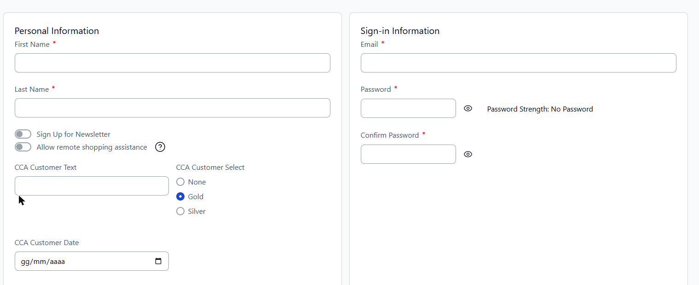
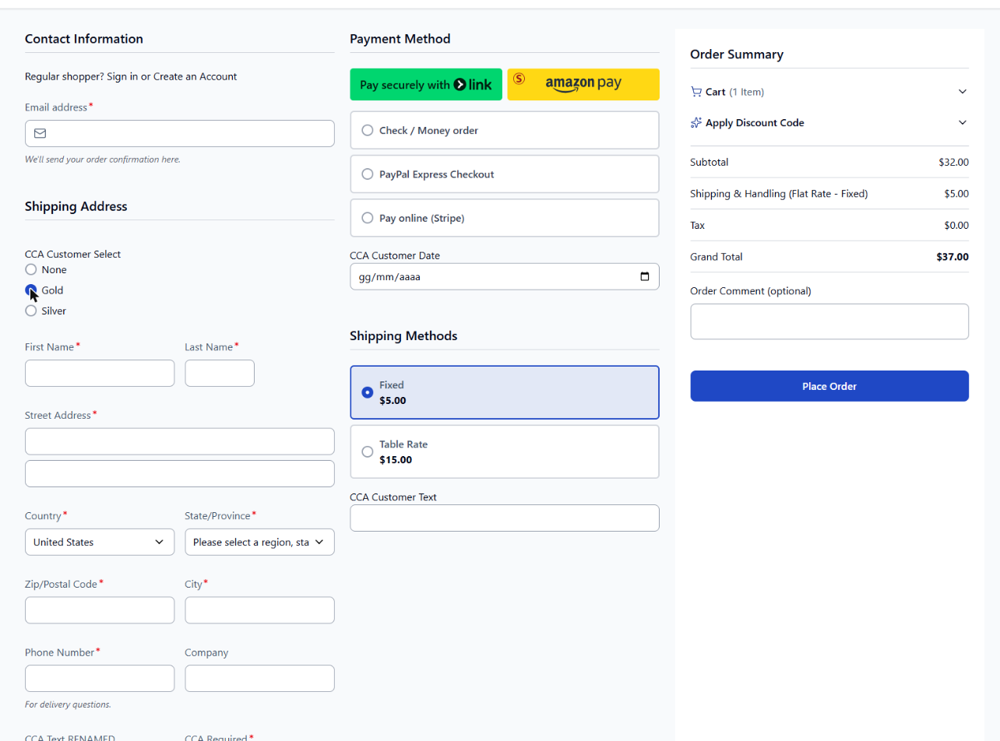

# 4. Customer attributes

Customer attributes describe the customer, not one address. They are created under **Stores → Attributes → Customer Attributes**.

## Registration and account

Tick **Customer Registration** and/or **Customer Account Edit** in Show in Forms. The attribute then appears in the Hyvä
registration form and in the Account Information form with native browser validation derived from its rules (required, length,
pattern, email, URL, date range). The values are saved by core Magento on the customer. Dropdown, yes/no and multiple select
attributes can be shown as radio buttons or checkboxes ([Managing attributes](03-managing-attributes.md)).

## Admin

Customer attributes are always part of the admin customer edit form. Tick **Admin Order Create (Account Information)** to show
them in the admin order form too (see [Orders and stored data](07-orders-and-data.md)).

## Customer attributes in the Hyvä Checkout

Tick **Hyvä Checkout** in Show in Forms (needs Hyvä Checkout and the companion module). Three more settings apply, listed below the Show in Forms
field (they are always shown, and greyed out while Hyvä Checkout is not ticked):

| Setting | Meaning |
|---|---|
| Position at Checkout Step | Above or Below Shipping Address, Above or Below Shipping Methods, Above or Below Payment Method, Order Summary |
| Checkout Sort Order | order inside a position, lower first |
| Prefill from Customer | fill an empty field with the logged-in customer's saved value |

How it behaves:

- Each position is a small section of the checkout. In the multi-step and mobile checkout it appears on the step that contains the
  position (the payment positions on the payment step, the order summary on the summary step).
- **Guests see the fields too.** The values are kept on the quote.
- **The customer account is never changed from the checkout.** What the customer types is saved on the quote and then on the
  order. An empty value in the account stays empty even if the customer filled the field at the checkout, and changes made to a
  prefilled field are not written back. This makes an attribute that is ticked only for the checkout (and the admin order form)
  behave like an *order attribute*: the value exists on the order only.
- **Prefill** runs when the checkout page loads and fills only fields that have no value yet. A guest who logs in during the
  checkout keeps what was typed; empty fields are prefilled. A field the customer clears is prefilled again at the next page load.
  Without prefill the default value is used, and a required attribute must be typed on every order.
- **Rules apply.** Customer group restrictions, dependency rules and website settings work like in the account forms. Dependent
  fields show and hide instantly, also when the parent field is in another section or on another step; a hidden value is dropped
  and a hidden required field does not block the order. See [Dependencies and groups](06-dependencies.md).
- **Required values** are checked before the order is placed: the order is blocked with a message such as *"CCA Customer Text" is a
  required value.* Orders placed through the REST API are not forced to supply them (the cart endpoints have no field for customer
  attributes).
- A virtual-only cart has no shipping step: sections placed at a shipping position (above or below the shipping address or the
  shipping methods) are not shown and their attributes are not required there. Use a payment position or the order summary for
  attributes that must also be collected for virtual products.
- If a guest types values and then logs in: when the customer has no active cart, the guest's cart (with the typed values) becomes the
  customer's cart; when the customer already has an active cart, the items are merged into it and that cart's values stay (the guest
  cart's typed values go with the guest cart).
- Attributes not ticked for the checkout keep working as before: their value is read from the customer when a logged-in customer
  places an order.

## What an order gets

When an order is placed, a snapshot of the customer attribute values is stored with the order: code, label, input type, value
and the displayed value. It is shown in the admin order view under **Account Information** and returned by the order API as the
extension attribute `customer_attribute_values`. See [Orders and stored data](07-orders-and-data.md).
