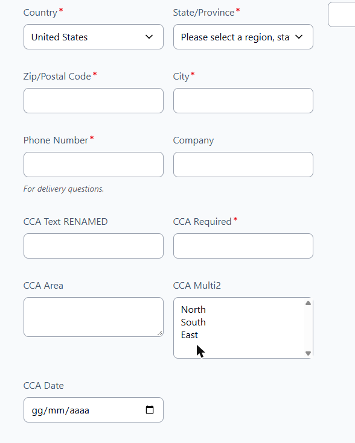

# 5. Address attributes

Address attributes are created under **Stores → Attributes → Customer Address Attributes** and describe one address.

## Where they appear

Pick the forms in **Show in Forms** ([Managing attributes](03-managing-attributes.md)):

- **Hyvä Checkout Address Forms:** the shipping and billing address forms. Values are saved on the quote address, copied to the
  order address and, when the customer saves the address to the address book, to the customer address. A saved address selected in
  the checkout loads its values into the quote. A saved address that has no value for an attribute clears values left from a
  previously selected address. Only attributes in this form (and enabled for the website) are kept on the quote and the order: the
  value a saved address has for an attribute that is only in the address book or the admin is not carried to the order.
- **Address Book (Customer Account):** the Add/Edit Address form in the account, with the saved values and native browser
  validation derived from the attribute's rules. A server-side validation message keeps everything the customer typed.
- **Registration Address Form:** the address part of the registration form.
- **Address Text:** see below.

Unticking "Hyvä Checkout Address Forms" removes the field from the checkout address forms.

## Address text

With **Address Text** ticked, the value is added after the standard address lines as "Label: value". Dates are shown without time
and select, multiselect and yes/no values as readable labels. This appears wherever an address is displayed through Magento's
address renderer:

- the checkout saved-address cards
- the account dashboard and address book cards
- the customer's order pages
- order emails and PDFs (html, text, pdf and one-line formats)
- the admin order, invoice and shipment views

Orders use their own snapshot, so a renamed or deleted attribute never changes an old order. An attribute with Address Text
switched off is hidden in all of these places.

## Dependencies and groups

Address attributes can be hidden by rules and customer groups, instantly in the Hyvä Checkout address forms. See
[Dependencies and groups](06-dependencies.md).

## A required attribute must be in the checkout form

Magento checks every **required** attribute of the address book form on the address of the quote when an order is placed. If an
address attribute is required and ticked for **Address Book (Customer Account)**, but not for **Hyvä Checkout Address Forms**, nobody can
fill it at the checkout and **no order can be placed** ("X" is a required value). The module keeps this behaviour of Magento and warns
you instead: the attribute's edit page shows a warning when the attribute is required (for the store or for one website), is in the
address book form and is not in the Hyvä Checkout address forms. Add the attribute to **Hyvä Checkout Address Forms** or make it
optional.

## Saved addresses that lack a required value

When an attribute becomes required after customers saved addresses, those addresses have no value. The module helps in two places:

- **Checkout notice:** next to the address list the Hyvä Checkout shows *"Your saved address needs the field X. Click here to edit
  it"* with a link to the account address form. When several fields are missing the text is generic ("Your saved address has some
  required fields missing"). Billing and shipping are checked independently. The link is shown only when the address book form
  ("Address Book (Customer Account)") has the missing field; for a field that is only in the checkout the notice says instead:
  *Choose "New Address" and type the address again to fill it in.* The attribute's edit page warns about such an attribute: add it to
  the address book form so that customers can complete their saved addresses.
- **Order message:** if the customer places the order anyway, the message names the address and, for one missing field, the field:
  *Your saved shipping address needs the field "X". Please edit the address in My Account > Address Book, or choose another address.*
  For a field that is only in the checkout it asks to choose "New Address" and type the address again.

Attributes that are hidden by a rule or a customer group are neither reported nor required. There is no automatic back-fill of
existing addresses.

## Per-website behaviour

An address attribute disabled for a website is absent from that website's checkout and forms; one required only for a website is
required only there ([Managing attributes](03-managing-attributes.md)).
