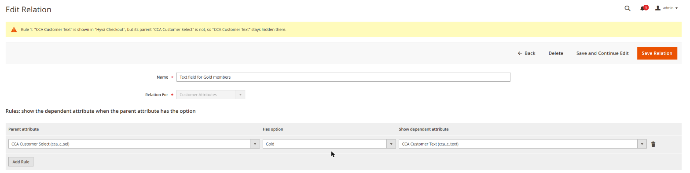

# 6. Dependencies and customer groups

Rules decide whether an attribute is visible. They apply to customer attributes and to address attributes separately.

## Attribute relations

**Stores → Attributes → Attribute Relations** holds named relations. Each relation is for either customer or address attributes
(chosen when it is created; it cannot change later) and contains rules:

> Show **dependent attribute** when **parent attribute** has **option**.

- The parent must be a dropdown, multiple select or yes/no attribute; the dependent can be any attribute.
- An attribute without rules is always visible. An attribute with rules is visible when at least one rule matches a visible
  parent that has the option. For a multiple select parent the dependent shows when any selected option matches.
- **Rules nest:** a dependent can be the parent of another rule. Circular rules are rejected when saving.
- Saving checks that the options exist, that the parent type is allowed, that a rule does not point to itself and that rules are
  not duplicated; a message names the rule number.

## Customer groups

On the Storefront Properties tab, **Customer Groups** limits an attribute to the selected groups. Empty means all groups. In the
checkout the group of the quote is used (0 for guests).

## Where the rules run

| Place | Behaviour |
|---|---|
| Hyvä account forms (customer and address) | the field is hidden and disabled; a dependent field appears for its option |
| Hyvä Checkout address forms | dependent fields show and hide **instantly** as the customer changes the parent; the server also clears hidden values. A group-restricted field is not rendered |
| Checkout sections for customer attributes | same, also when parent and dependent are in different sections or on different steps |
| Order placement (server) | hidden attributes are not required and their values are not kept on the order, whatever way the values arrived (browser, REST, admin) |
| Admin forms | always show every attribute |

When a parent is on another step of a multi-step checkout, the field keeps the state the server rendered.

## Relation warnings

The relation screen warns when a dependent attribute is shown in a storefront form where its parent is not: the parent never has
a value there, so the dependent stays hidden. The warning appears when you open or save the relation, for example:

> Rule 1: "Company number" is shown in "Hyvä Checkout", but its parent "Customer type" is not, so "Company number" stays hidden there.

The relation is still saved. Add the parent to the same forms to fix it.

## Tips

- Put parent and dependent in the same forms (Show in Forms).
- Delete a relation in its edit page; deleting an attribute removes its rules and group rows.
- Required dependent attributes only count when they are visible.
