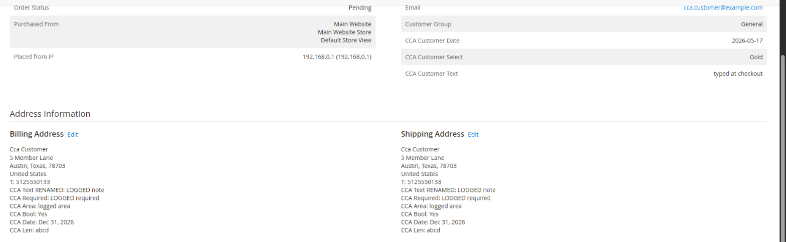

# 7. Orders and stored data

## Order snapshots

When an order is placed the module stores what the customer entered **as it was at that moment**:

- per order address (billing and shipping): attribute code, label, input type, value and displayed value;
- per order (customer attributes): the same fields.

The order tables have **no link to the attribute**. Renaming an attribute, changing an option, changing the input type or deleting
the attribute never changes an existing order. Deleting an order deletes its snapshot rows.

## Where values show up

| Place | What is shown |
|---|---|
| Customer order page, order emails, PDFs | address custom values after the address lines (attributes with Address Text on) |
| Admin order view | address values after the billing and shipping address; customer values under **Account Information** |
| Admin invoice and shipment views | address values after the address |
| Order API | extension attributes, see [API](08-api.md) |



## Admin: creating and editing orders

- **Order create:** customer attributes ticked for "Admin Order Create (Account Information)" appear in Account Information,
  prefilled from the customer. Address attributes appear in the billing and shipping forms; choosing a saved customer address fills
  them. The values typed in the form are stored on the order (they are not written to the customer unless "Add to address book" is
  used for addresses). The values are validated when the order is placed.
- **Edit Order Address:** shows the order's values and updates the snapshot. Dates are parsed in the admin locale, a cleared value
  removes its row, and invalid values are rejected with a message.
- The admin forms show every attribute (rules and groups do not hide fields there), but when the order is placed values of attributes
  that a rule or group would hide are dropped, as on the storefront.

## Validation at order placement

Whatever way the values reached the quote (Hyvä Checkout, REST, admin), they are validated against the attribute rules when the
order is placed: required, text length, letters/numbers/email/URL patterns, date range and allowed options. A rejected order
names the address and the attribute. Values of attributes hidden by a rule or customer group are removed first and are not
required.

## Stored data

All tables are declared in `etc/db_schema.xml`; nothing alters tables at runtime.

| Table | Content |
|---|---|
| `mageos_cca_quote_address_value` | quote address id, attribute id, value |
| `mageos_cca_quote_value` | quote id, attribute id, value (customer attributes typed in the checkout) |
| `mageos_cca_order_address_value` | order address id, attribute code, label, input type, value, value label (snapshot) |
| `mageos_cca_order_value` | order id, attribute code, label, input type, value, value label (snapshot of customer attributes) |
| `mageos_cca_relation`, `mageos_cca_relation_detail` | relations and their rules |
| `mageos_cca_attribute_group` | customer group restrictions |

Values of customers and customer addresses live in the core EAV value tables (`customer_entity_*`, `customer_address_entity_*`).
Per-website overrides use core's `customer_eav_attribute_website`.

### Value formats

| Input | Stored value |
|---|---|
| text, text area | the text |
| dropdown | option id |
| multiple select | comma-separated option ids, for example `12,14` |
| yes/no | `1` or `0` |
| date | `YYYY-MM-DD HH:MM:SS` |

The snapshot's *value label* holds the readable text (option labels, a date as YYYY-MM-DD without the time).

### Reading the order values with SQL

```sql
-- address values of the latest order
SELECT oa.address_type, v.attribute_code, v.attribute_label, v.value, v.value_label
FROM sales_order_address oa
JOIN mageos_cca_order_address_value v ON v.order_address_id = oa.entity_id
WHERE oa.parent_id = (SELECT MAX(entity_id) FROM sales_order);

-- customer attribute values of the latest order
SELECT attribute_code, attribute_label, value, value_label
FROM mageos_cca_order_value
WHERE order_id = (SELECT MAX(entity_id) FROM sales_order);
```

There are no order grid columns or filters for the values in this version.
